---
puppeteer:
    pdf:
        format: A4
        displayHeaderFooter: true
        landscape: false
        scale: 0.8
        margin:
            top: 1.2cm
            right: 1cm
            bottom: 1cm
            left: 1cm
    image:
        quality: 100
        fullPage: false
---

Open DID CA Admin Operation Guide
==

- Date: 2026-11-06
- Version: v3.0.0

Revision History
==
| Version | Date       | Changes                            |
| ------- | ---------- | ---------------------------------- |
| v1.0.0  | 2025-03-31 | Initial version                    |
| v1.0.1  | 2025-04-24 | Added `3.1.1. CA Registration` chapter |
| v2.0.0  | 2025-05-29 | Version update                     |
| v3.0.0  | 2026-11-06 | Added API Log and Audit API Log guidance, retook the screen examples, and expanded chapter 3 with item tables aligned with the screens |

Table of Contents
==

- [1. Introduction](#1-introduction)
  - [1.1. Overview](#11-overview)
  - [1.2. Admin Console Definition](#12-admin-console-definition)
- [2. Basic Manual](#2-basic-manual)
  - [2.1. Login](#21-login)
  - [2.2. Main Screen Configuration](#22-main-screen-configuration)
  - [2.3. Menu Configuration](#23-menu-configuration)
    - [2.3.1. CA Unregistered State](#231-ca-unregistered-state)
    - [2.3.2. CA Registered State](#232-ca-registered-state)
  - [2.4. Password Change Management](#24-password-change-management)
- [3. Feature-specific Detailed Manual](#3-feature-specific-detailed-manual)
  - [3.1. CA Management](#31-ca-management)
    - [3.1.1. CA Registration](#311-ca-registration)
    - [3.1.2. Registered CA Management](#312-registered-ca-management)
  - [3.2. User Management](#32-user-management)
    - [3.2.1. User List Inquiry](#321-user-list-inquiry)
    - [3.2.2. User Detailed Information Inquiry](#322-user-detailed-information-inquiry)
  - [3.3. Admin Management](#33-admin-management)
    - [3.3.1. Admin List](#331-admin-list)
    - [3.3.2. Admin Registration](#332-admin-registration)
  - [3.4. Log Management](#34-log-management)
    - [3.4.1. API Log](#341-api-log)
    - [3.4.2. Audit API Log](#342-audit-api-log)
  - [3.5. Server Configuration](#35-server-configuration)
  - [3.6. Password Policy Settings](#36-password-policy-settings)

# 1. Introduction

## 1.1. Overview

This document provides a guide on how to use the Open DID CA Admin Console. It explains the features and usage methods step by step so that administrators can efficiently manage and operate the CA (Client Application) system.

For the overall installation guide of OpenDID, please refer to [Open DID Installation Guide].

## 1.2. Admin Console Definition

The CA Admin Console is a web-based management tool for managing the registration information, user information, and administrator accounts of the CA (Client Application) server in the Open DID system. Through this console, administrators can check the server status and perform the required settings.

The CA Admin Console provides the following main features:

- CA basic information management
- User information inquiry
- Administrator account management
- API call and administrator activity log lookup
- API key settings for external server integration
- Administrator password policy settings

<br/>

# 2. Basic Manual

## 2.1. Login

To access the Admin Console, follow these steps:

1. Open a web browser and access the CA Admin Console URL.

   ```
   http://<ca_domain>:<port>
   ```

2. On the login screen, enter the administrator account email and password.
   - Default administrator account: <admin@opendid.omnione.net>
   - Initial password: password (ID and password must be changed upon first login)

3. Click the 'Login' button.

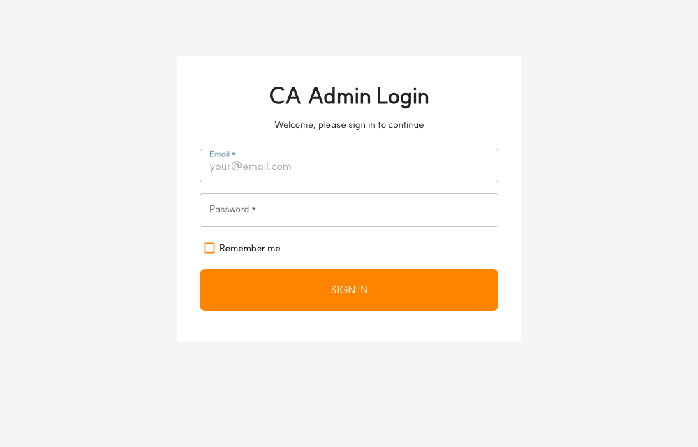

> **Note**: For security reasons, the default administrator account must change its ID and password upon first login.

<br/>

## 2.2. Main Screen Configuration

The main screen displayed after login consists of the following elements:

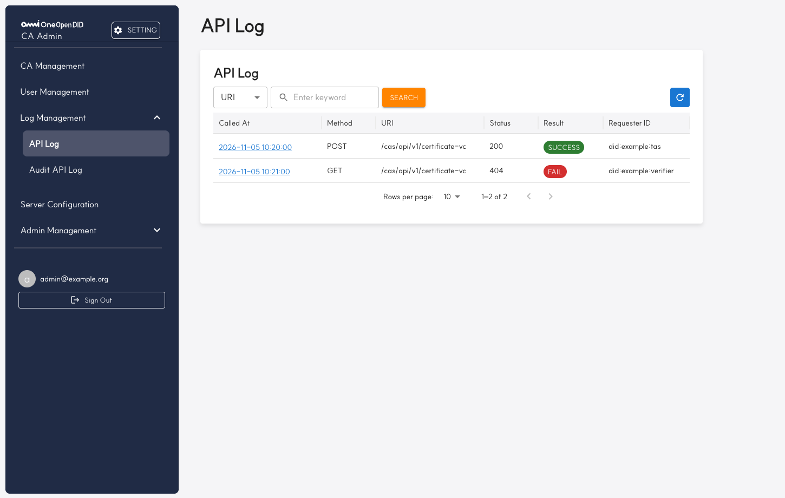

> Screen rendered with example data.

| Number | Area             | Description                                                                                                                     |
| ------ | ---------------- | ------------------------------------------------------------------------------------------------------------------------------- |
| 1      | Header Area      | You can navigate to the password change screen through the `SETTING` button in the upper right corner.                         |
| 2      | Content Area     | Displays the title of the currently selected menu and its corresponding content. Screen content changes according to each menu. |
| 3      | Side Menu        | Located on the left side of the screen, with main menu items arranged vertically. Selected menu is highlighted, and sub-menus expand when necessary. |
| 4      | User Info Area   | Displays the email address of the currently logged-in administrator and the 'Sign Out' button.                                  |

<br/>

## 2.3. Menu Configuration

The sidebar menu of the CA Admin Console **differs in screen configuration depending on the CA registration status**.

<br/>

### 2.3.1. CA Unregistered State

In the initial state where the CA server is not yet registered, only the `CA Registration` item is displayed alone in the menu.

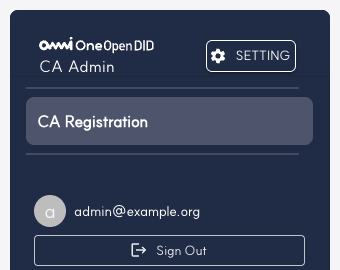

### 2.3.2. CA Registered State

Once CA registration is completed, all management functions are activated, and the sidebar menu is configured as follows:

| Number | Function Name | Function Description |
|--------|---------------|---------------------|
| 1 | **CA Management** | Menu to check and manage basic information of the CA server (DID, URL, etc.). |
| 2 | **User Management** | Menu to inquire about user information registered in the system. You can check users' personally identifiable information (PII). |
| 3 | **Log Management** | View Agent API calls in `API Log` and administrator API activity in `Audit API Log`. |
| 4 | **Server Configuration** | Manage external server integration settings. |
| 5 | **Admin Management** | Parent menu for administrator settings. It contains `Admin Management` (administrator accounts) and `Password Policy Settings` (password policy). |

Detailed functions for each menu are explained in detail in the [3. Feature-specific Detailed Manual](#3-feature-specific-detailed-manual) section.

<br/>

## 2.4. Password Change Management

User password change can be performed through the following steps:

1. Click the 'SETTING' button in the header area.
2. Select 'Password Change' from the settings menu.
3. On the password change screen:
   - Enter current password
   - Enter new password
   - Confirm new password
4. Click the 'Save' button to apply changes.

> **Note**: See [Password Policy Settings](#36-password-policy-settings) for the minimum length, expiration period, and composition rules that apply.

<br/>

# 3. Feature-specific Detailed Manual

> Screens were captured with example data. Actual data varies by environment.

This chapter provides detailed usage instructions for the main functions of the Open DID CA Admin Console.

## 3.1. CA Management

CA Management registers the CA server and manages its status.

The CA server guarantees users' Client Applications in the Open DID system. After a Client Application is authenticated through the CA server, it can use a Wallet for main functions such as DID creation and VC issuance.

CA registration is performed only once. After that, the registered status can be checked on the management screen.

<br/>

### 3.1.1. CA Registration

While the CA server is not registered, only the `CA Registration` item is shown in the left menu. CA registration has three steps.

<br/>

**Step 1 – Enter CA Info**

Enter the name and server URL of the CA.

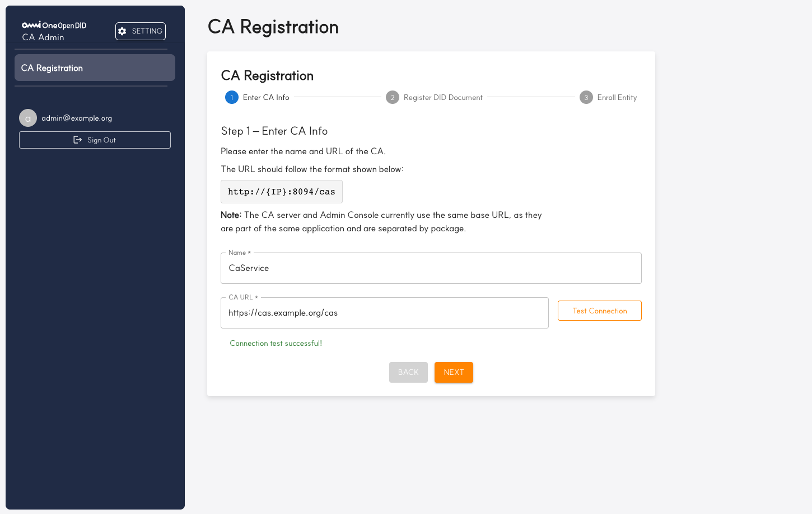

| No. | Item | Description |
| --- | --- | --- |
| 1 | **Name*** | Name of the CA server. Use 3 to 20 English characters. Example: `CaService` |
| 2 | **CA URL*** | Call URL of the CA server (up to 200 characters). Format: `http://<IP>:8094/cas`. Example on the screen: `https://cas.example.org/cas` |
| 3 | **TEST CONNECTION Button** | Tests the connection to the entered URL. |
| 4 | **NEXT Button** | Saves the information and moves to the next step. |

<br/>

**Step 2 – Register DID Document**

Generate the DID Document of the CA, request its registration from the TA, and check the TA administrator's approval. A registered DID Document **cannot be changed or registered again.**

▶ **Generate DID Document**

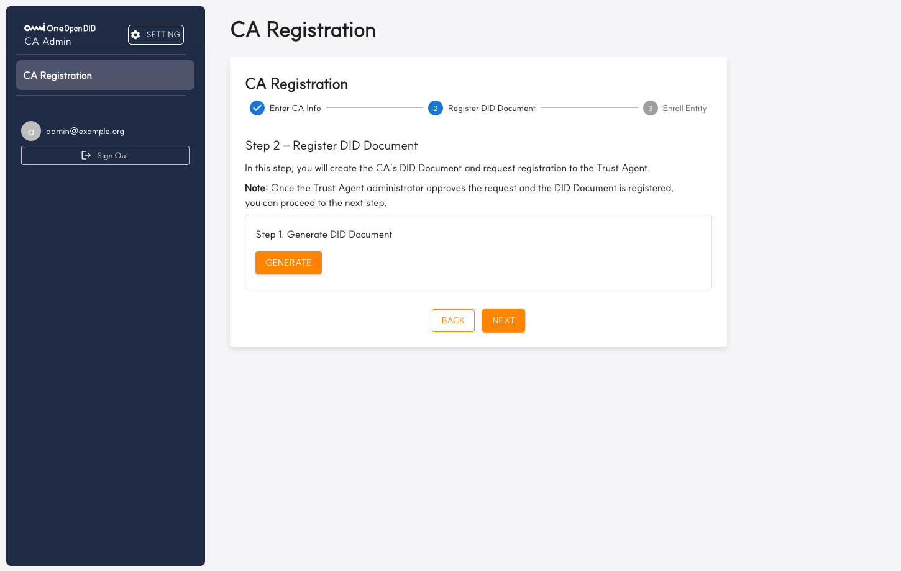

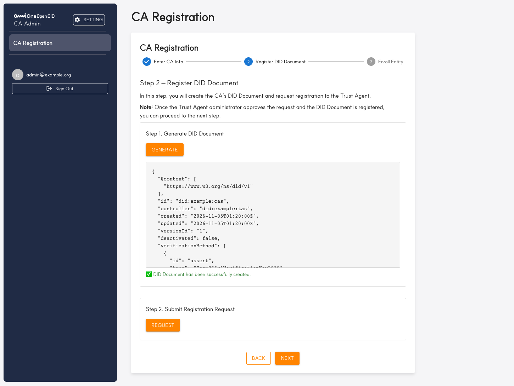

Click `GENERATE` to create the DID Document, which is shown as JSON on the screen. The completion message is `DID Document has been successfully created.`

▶ **Submit Registration Request**

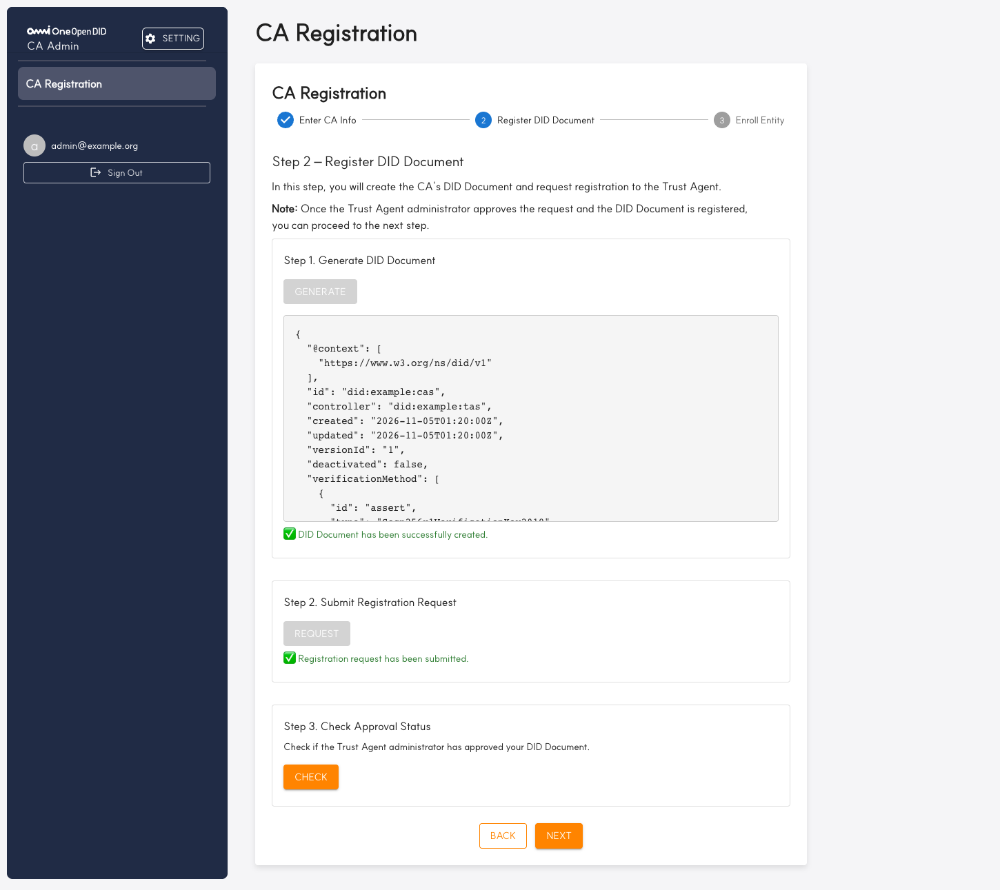

Click `REQUEST` to request DID Document registration from the TA. The completion message is `Registration request has been submitted.` The TA administrator approves the request on the Entity detail screen of the TA Admin Console.

▶ **Check Approval Status**

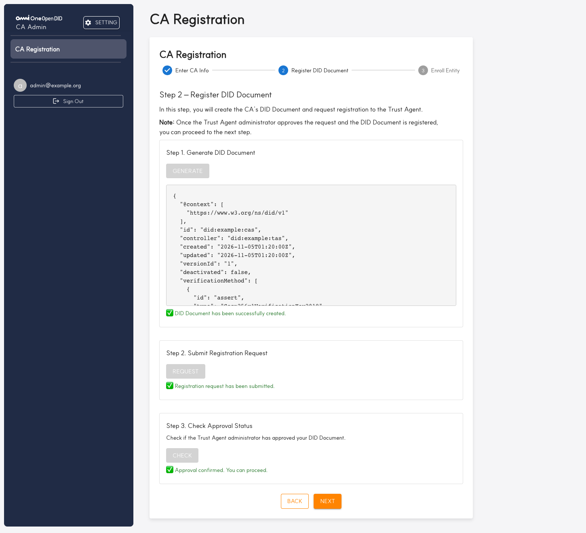

Click `CHECK` to check whether the request was approved.

| State | Message | Action |
| --- | --- | --- |
| Pending | `The DID Document registration request is still pending approval.` | Check again after approval. |
| Approved | `Approval confirmed. You can proceed.` | Click `NEXT` to move to the next step. |
| Rejected | `The DID Document registration request has been rejected.` | Returns to the first screen. |

<br/>

**Step 3 – Register Entity and Issue Certificate VC**

Register the CA as an Entity with the TA and receive its certificate VC. CA Admin performs the Entity registration protocol (P120) of the TA.

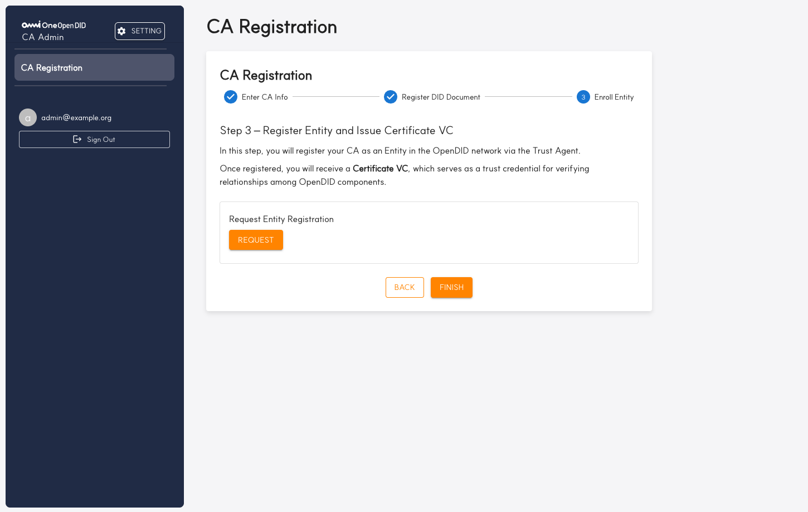

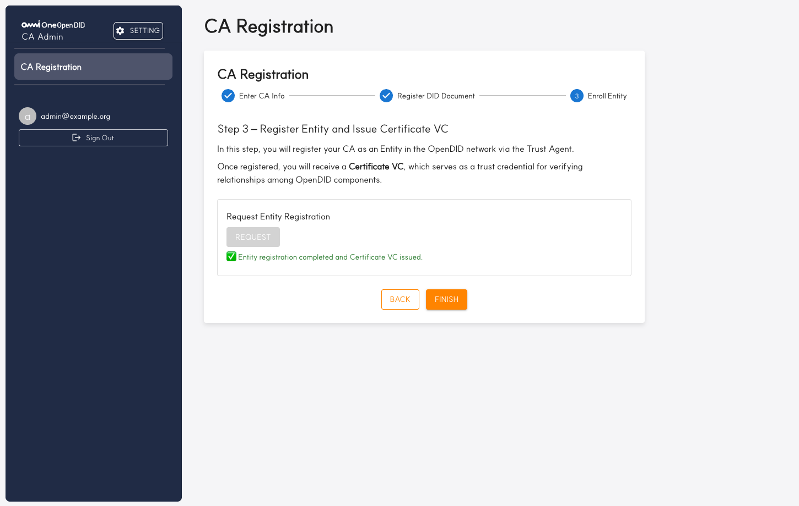

| No. | Item | Description |
| --- | --- | --- |
| 1 | **REQUEST Button** | Requests Entity registration from the TA. When it completes, `Entity registration completed and Certificate VC issued.` is shown. |
| 2 | **BACK Button** | Moves to the previous step. |
| 3 | **FINISH Button** | Finishes registration and opens the completion screen. |

<br/>

### 3.1.2. Registered CA Management

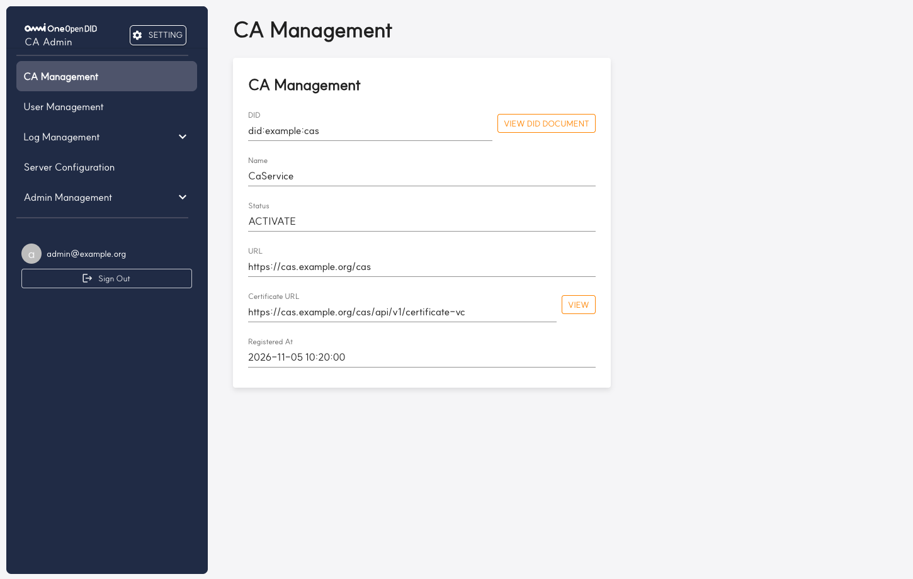

| No. | Item | Description |
| --- | --- | --- |
| 1 | **DID** | Unique identifier of the CA. |
| 2 | **VIEW DID DOCUMENT Button** | Shows the DID Document in a popup. |
| 3 | **Name** | Name of the CA. |
| 4 | **Status** | Registration status.<br/>- `DID_DOCUMENT_REQUIRED`: DID Document not registered yet<br/>- `DID_DOCUMENT_REQUESTED`: Requested and waiting for approval<br/>- `CERTIFICATE_VC_REQUIRED`: Approved, certificate VC not issued yet<br/>- `ACTIVATE`: Registration complete<br/>- `DEACTIVATE`: Inactive |
| 5 | **URL** | Base URL of the CA service. |
| 6 | **Certificate URL** | URL where the certificate VC can be checked. |
| 7 | **VIEW Button** | Button next to Certificate URL. Shows the certificate VC issued by the TA in a popup. |
| 8 | **Registered At** | Date and time the CA was registered. |

<br/>

## 3.2. User Management

This menu shows the user information registered in the system. It is read-only and has no function for adding, editing, or deleting user information.

<br/>

### 3.2.1. User List Inquiry

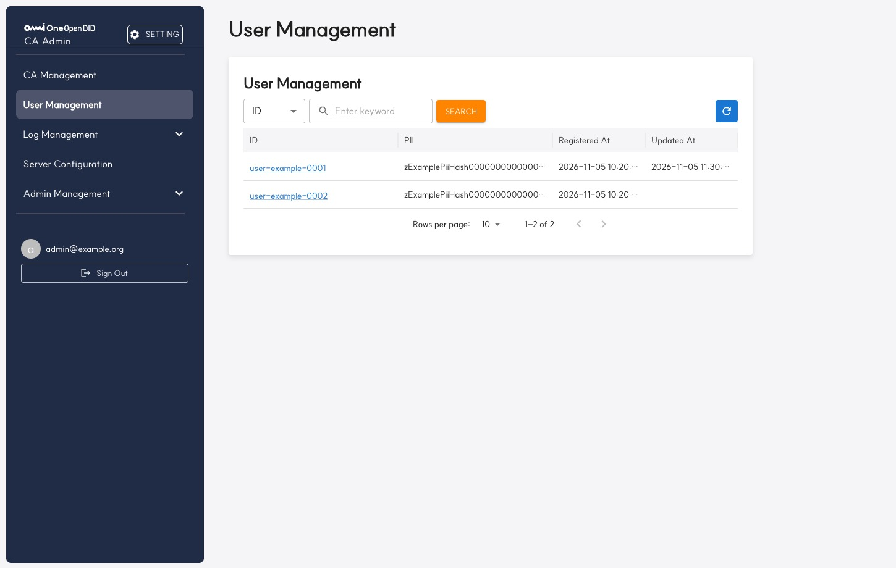

| No. | Item | Description |
| --- | --- | --- |
| 1 | **Search** | Searches by ID or PII. |
| 2 | **ID** | Unique identifier of the user. Click to open the detail screen. |
| 3 | **PII** | Personally identifiable information of the user. |
| 4 | **Registered At** | Date and time the user was registered. |
| 5 | **Updated At** | Date and time of the last modification. |

<br/>

### 3.2.2. User Detailed Information Inquiry

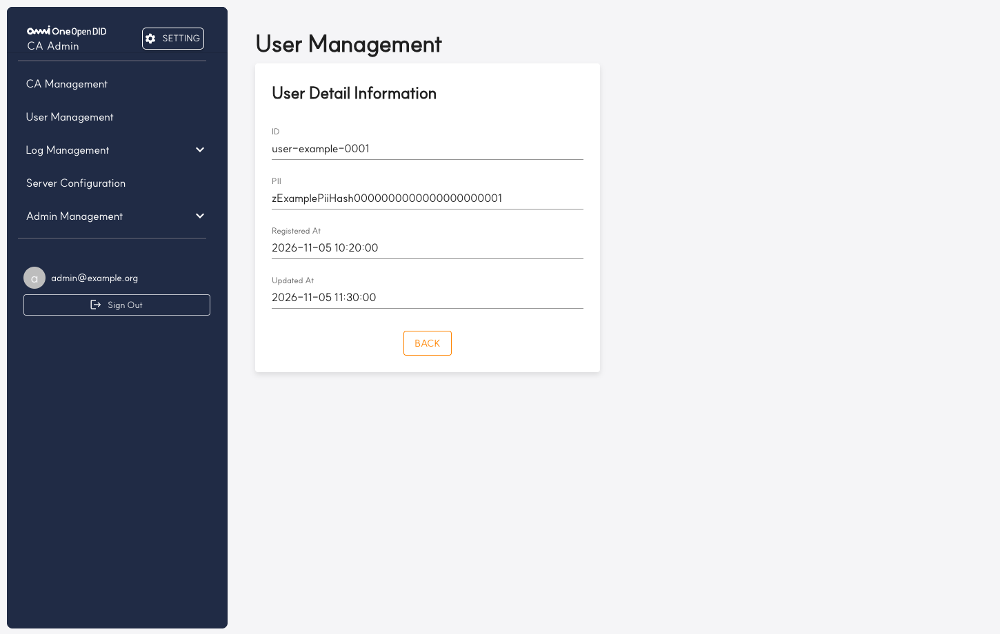

| No. | Item | Description |
| --- | --- | --- |
| 1 | **ID** | Unique identifier of the user. |
| 2 | **PII** | Personally identifiable information of the user. |
| 3 | **Registered At** | Date and time the user was registered. |
| 4 | **Updated At** | Date and time of the last modification. |
| 5 | **BACK Button** | Returns to the list. |

> **Important**: Personally identifiable information (PII) is currently an arbitrary value entered through the Demo Server. The CA server provides this view because it is set up as the holder of user information.

<br/>

## 3.3. Admin Management

The `Admin Management` menu manages the administrator accounts that can access the CA Admin Console.

When the CA server is installed, the `admin@opendid.omnione.net` account is created automatically with ROOT permission. It is the only ROOT account in the system and cannot be deleted.

Administrator accounts have two permission types: **ROOT** and **Normal Admin**.

> **Note**: Currently, the only difference between ROOT and Normal Admin is the buttons shown in the `Admin Management` menu (only ROOT can use `REGISTER`, `DELETE`, and `CHANGE PASSWORD`). Access to other menus is not restricted yet.

<br/>

### 3.3.1. Admin List

The `Admin Management` menu shows the list of registered administrator accounts.

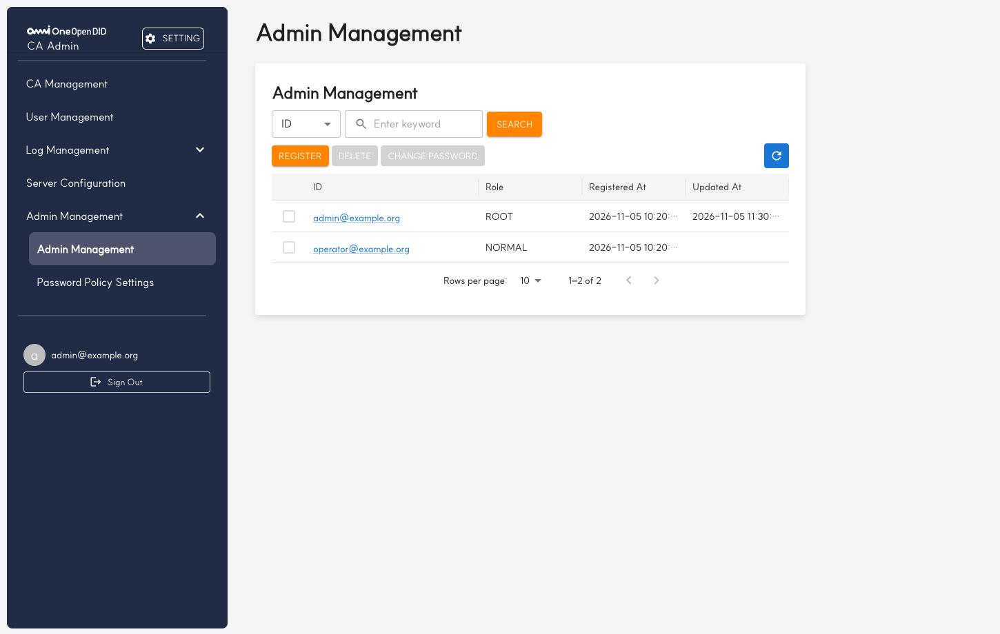

| No. | Item | Description |
| --- | --- | --- |
| 1 | **Search** | Searches by ID or Role (Root, Normal). |
| 2 | **REGISTER Button** | Opens the screen for registering a new administrator account. |
| 3 | **DELETE Button** | Deletes the selected administrator account. Only ROOT can do this. |
| 4 | **CHANGE PASSWORD Button** | Changes the password of the selected administrator account. |
| 5 | **ID** | Email ID of the administrator account. |
| 6 | **Role** | Permission of the administrator account. |
| 7 | **Registered At** | Date and time the account was registered. |
| 8 | **Updated At** | Date and time of the last modification. |

<br/>

### 3.3.2. Admin Registration

Click `REGISTER` to open the registration screen.

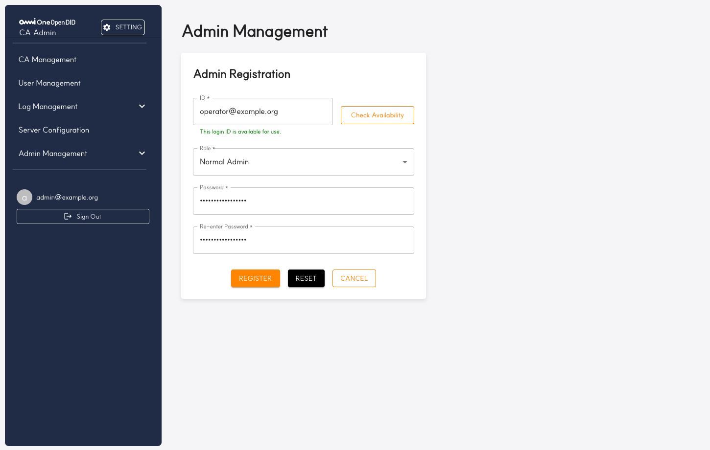

| No. | Item | Description |
| --- | --- | --- |
| 1 | **ID*** | ID of the administrator account. Use an email address of 3 to 30 characters. Example: `operator@example.org` |
| 2 | **Check Availability Button** | Checks that the ID is not already in use. The check must pass before registering. |
| 3 | **Role** | Select the permission of the account. Example: `Normal Admin` |
| 4 | **Password*** | Password used to sign in (8 to 30 characters). If the password policy is on, its rules also apply. |
| 5 | **Re-enter Password*** | Enter the password again. |
| 6 | **REGISTER Button** | Registers the administrator account with the entered information. |
| 7 | **RESET Button** | Resets the input. |
| 8 | **CANCEL Button** | Cancels and returns to the previous screen. |

<br/>

## 3.4. Log Management

Once CA is registered, API call records are available under `Log Management` in the sidebar. Both screens show the newest records first, page by page, and the refresh button reloads the list. Click `Called At` to open the detail dialog. Logs are read-only.

<br/>

### 3.4.1. API Log

`Log Management > API Log` (`/logs/api`) shows CA Agent API calls.


| No. | Item | Description |
| --- | --- | --- |
| 1 | **Search** | Searches by `URI` or `Result` (`SUCCESS`, `FAIL`). |
| 2 | **Called At** | Date and time of the call. Click to open the detail dialog. |
| 3 | **Method** | HTTP method. |
| 4 | **URI** | Called URI. |
| 5 | **Status** | HTTP status code. |
| 6 | **Result** | `SUCCESS` or `FAIL`. |
| 7 | **Requester ID** | Requester ID. |

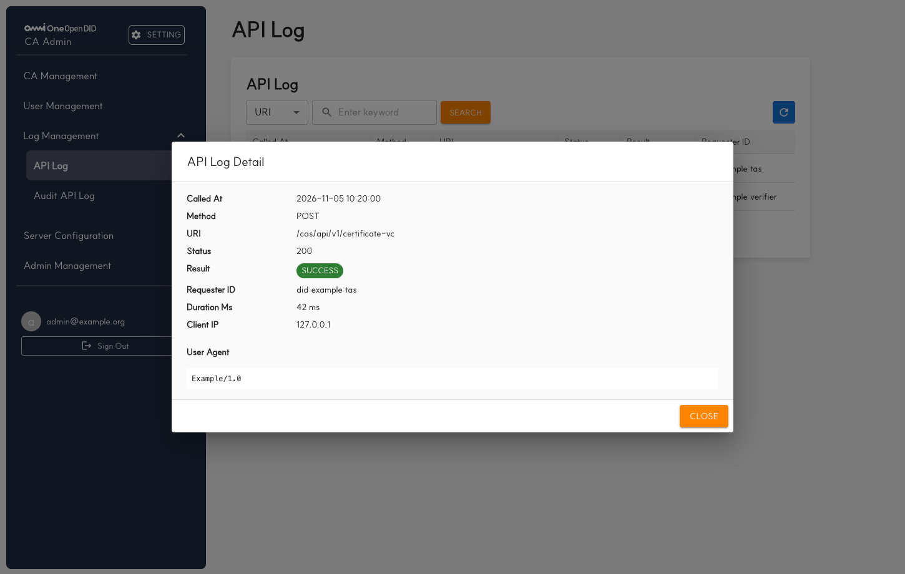

In addition to the list items, the detail dialog shows the following.

| Item | Description |
| --- | --- |
| **Duration Ms** | Processing time in milliseconds. |
| **Client IP** | Client IP address. |
| **User Agent** | User Agent of the request. |
| **Message** | Shown when an error message was recorded. |

<br/>

### 3.4.2. Audit API Log

`Log Management > Audit API Log` (`/logs/audit`) shows administrator operations performed through Admin APIs.

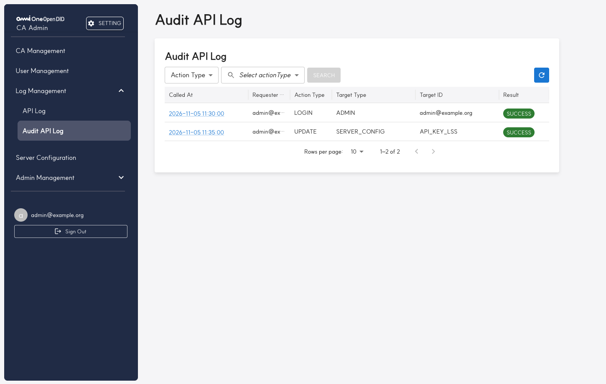

| No. | Item | Description |
| --- | --- | --- |
| 1 | **Search** | Searches by `Action Type`, `Target Type`, `Result`, or `Requester ID`. `Action Type` is selected from `NONE`, `CREATE`, `UPDATE`, `DELETE`, `LOGIN`, and `LOGOUT`. |
| 2 | **Called At** | Date and time of the call. Click to open the detail dialog. |
| 3 | **Requester ID** | ID of the administrator who performed the operation. |
| 4 | **Action Type** | Operation type. |
| 5 | **Target Type** | Type of the target. |
| 6 | **Target ID** | ID of the target. |
| 7 | **Result** | `SUCCESS` or `FAIL`. |

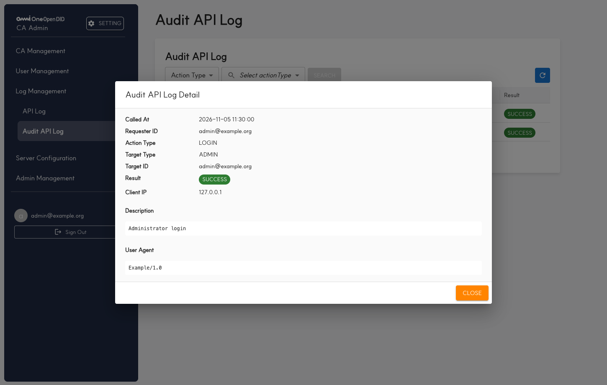

In addition to the list items, the detail dialog shows the following.

| Item | Description |
| --- | --- |
| **Client IP** | Client IP address. |
| **Description** | Description of the operation. |
| **User Agent** | User Agent of the request. |
| **Message** | Shown when an error message was recorded. |

> Logs are created from API calls that use `@ArticleLog` on the server. If the result is `FAIL`, check the status code in API Log and the detail message of that log.

## 3.5. Server Configuration

`Server Configuration` sets API keys for integrating with external servers.

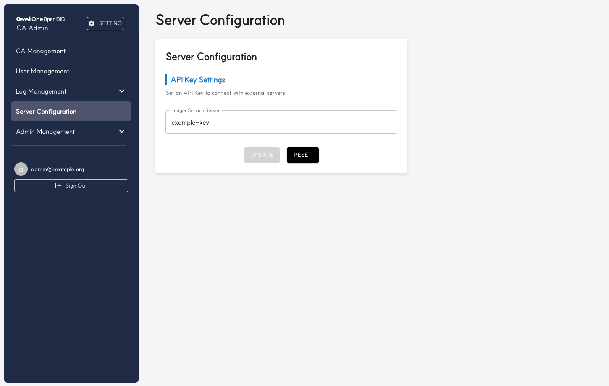

| No. | Item | Description |
| --- | --- | --- |
| 1 | **Ledger Service Server** | Enter the API key issued by LSS. It is stored as `API_KEY_LSS`, and the CA server sends it in the `X-API-Key` header when calling LSS (`lss` profile). |
| 2 | **UPDATE Button** | Saves the entered value. |
| 3 | **RESET Button** | Resets the input before saving. |

If no key is registered, LSS calls fail with `SCRVCFA01801`.

> **Caution**: Do not include API key values in screen captures, documents, or sample settings.

## 3.6. Password Policy Settings

`Admin Management > Password Policy Settings` sets the password rules for administrators. The rules apply when an account is registered and when a password is changed.

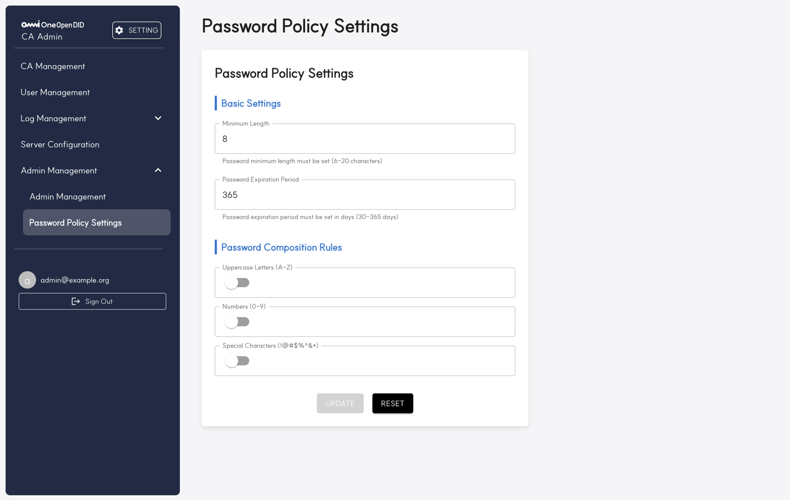

| No. | Item | Description |
| --- | --- | --- |
| 1 | **Minimum Length** | Minimum password length, from 6 to 20 characters. The default is 8. |
| 2 | **Password Expiration Period** | Password expiration period, from 30 to 365 days. The default is 365. |
| 3 | **Uppercase Letters (A-Z)** | Requires at least one uppercase letter. Off by default. |
| 4 | **Numbers (0-9)** | Requires at least one number. Off by default. |
| 5 | **Special Characters (!@#$%^&*)** | Requires at least one special character. Off by default. |
| 6 | **UPDATE Button** | Saves the policy. If no policy is registered yet, the button is named `REGISTER`. |
| 7 | **RESET Button** | Reverts to the input before the change. |

[Open DID Installation Guide]: https://github.com/OmniOneID/did-release/blob/main/release-V2.0.0.0/OpenDID_Installation_Guide-V2.0.0.0.md
