---
puppeteer:
    pdf:
        format: A4
        displayHeaderFooter: true
        landscape: false
        scale: 0.8
        margin:
            top: 1.2cm
            right: 1cm
            bottom: 1cm
            left: 1cm
    image:
        quality: 100
        fullPage: false
---

Open DID CA Admin Operation Guide
==

- Date: 2026-11-06
- Version: v3.0.0

개정 이력
==
| 버전   | 일자       | 변경 내용                  |
| ------ | ---------- | -------------------------- |
| v1.0.0 | 2025-03-31 | 최초 작성                  |
| v1.0.1 | 2025-04-24 | `3.1.1. CA 등록` 장 추가 |
| v2.0.0 | 2025-05-29 | 버전 업 |
| v3.0.0 | 2026-11-06 | API Log 및 Audit API Log 메뉴와 조회 방법 추가, 화면 예시 재촬영, 3장을 항목 표로 보강하고 화면과 일치시킴 |

목차
==

- [1. 소개](#1-소개)
  - [1.1. 개요](#11-개요)
  - [1.2. Admin Console 정의](#12-admin-console-정의)
- [2. 기본 메뉴얼](#2-기본-메뉴얼)
  - [2.1. 로그인](#21-로그인)
  - [2.2. 메인 화면 구성](#22-메인-화면-구성)
  - [2.3. 메뉴 구성](#23-메뉴-구성)
    - [2.3.1. CA 미등록 상태](#231-ca-미등록-상태)
    - [2.3.2. CA 등록 상태](#232-ca-등록-상태)
  - [2.4. 비밀번호 변경 관리](#24-비밀번호-변경-관리)
- [3. 기능별 상세 메뉴얼](#3-기능별-상세-메뉴얼)
  - [3.1. CA Management](#31-ca-management)
    - [3.1.1. CA 등록](#311-ca-등록)
    - [3.1.2. 등록된 CA 관리](#312-등록된-ca-관리)
  - [3.2. User Management](#32-user-management)
    - [3.2.1. 사용자 목록 조회](#321-사용자-목록-조회)
    - [3.2.2. 사용자 상세 정보 조회](#322-사용자-상세-정보-조회)
  - [3.3. Admin Management](#33-admin-management)
    - [3.3.1. Admin 목록 조회](#331-admin-목록-조회)
    - [3.3.2. Admin 등록](#332-admin-등록)
  - [3.4. Log Management](#34-log-management)
    - [3.4.1. API Log](#341-api-log)
    - [3.4.2. Audit API Log](#342-audit-api-log)
  - [3.5. Server Configuration](#35-server-configuration)
  - [3.6. Password Policy Settings](#36-password-policy-settings)

# 1. 소개

## 1.1. 개요

본 문서는 Open DID CA Admin Console의 사용 방법에 관한 가이드를 제공합니다. 관리자가 CA(Client Application) 시스템을 효율적으로 관리하고 운영할 수 있도록 기능 및 사용 방법을 단계별로 설명합니다.

OpenDID의 전체 설치에 대한 가이드는 [Open DID Installation Guide]를 참고해 주세요.

## 1.2. Admin Console 정의

CA Admin Console은 Open DID 시스템에서 CA(Client Application) 서버의 등록 정보, 사용자 정보, 관리자 계정을 관리하기 위한 웹 기반 관리 도구입니다. 관리자는 이 콘솔을 통해 서버 상태를 확인하고 필요한 설정을 수행할 수 있습니다.

CA Admin Console은 다음과 같은 주요 기능을 제공합니다:

- CA 기본 정보 관리
- 사용자 정보 조회
- 관리자 계정 관리
- API 호출 및 관리자 작업 로그 조회
- 외부 서버 연동용 API 키 설정
- 관리자 비밀번호 정책 설정

<br/>

# 2. 기본 메뉴얼

## 2.1. 로그인

Admin Console에 접속하려면 다음 단계를 따르세요:

1. 웹 브라우저를 열고 CA Admin Console URL에 접속합니다.

   ```
   http://<ca_domain>:<port>
   ```

2. 로그인 화면에서 관리자 계정의 이메일과 비밀번호를 입력합니다.
   - 기본 관리자 계정: <admin@opendid.omnione.net>
   - 초기 비밀번호: password (최초 로그인 시 ID와 비밀번호 변경 필요)

3. '로그인' 버튼을 클릭합니다.

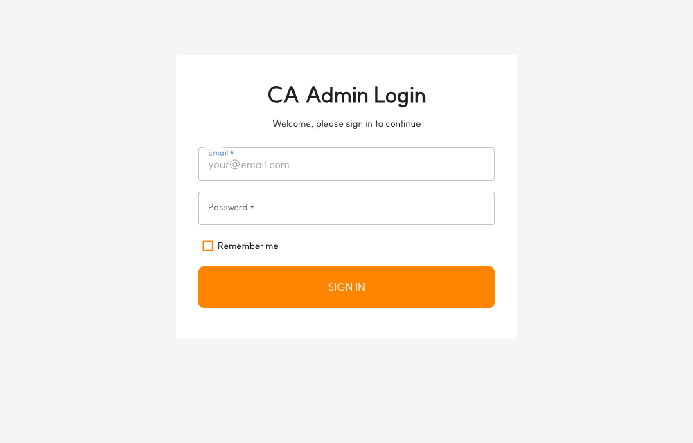

> **참고**: 보안상의 이유로 기본 관리자 계정은 최초 로그인 시 ID와 비밀번호를 변경해야 합니다.

<br/>

## 2.2. 메인 화면 구성

로그인 후 표시되는 메인 화면은 다음과 같은 요소로 구성됩니다:

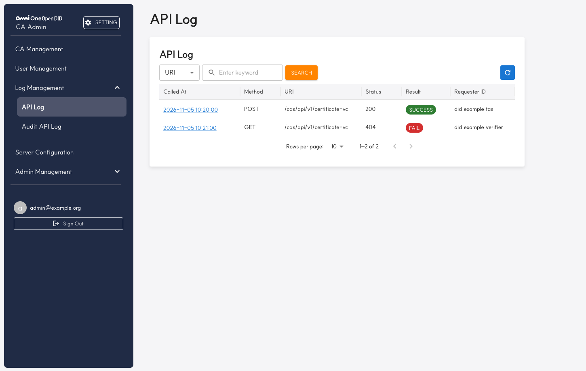

> 예시 데이터로 렌더링한 화면입니다.

| 번호 | 영역             | 설명                                                                                                                                |
| ---- | ---------------- | ----------------------------------------------------------------------------------------------------------------------------------- |
| 1    | 헤더 영역        | 우측 상단의 `SETTING` 버튼을 통해 비밀번호 변경 화면으로 이동할 수 있습니다.                                                        |
| 2    | 콘텐츠 영역      | 현재 선택된 메뉴의 제목과 해당 콘텐츠가 표시됩니다. 각 메뉴에 따라 화면 내용이 바뀝니다.                                            |
| 3    | 사이드 메뉴      | 화면 왼쪽에 위치하며, 주요 메뉴 항목들이 세로로 정렬되어 있습니다. 선택한 메뉴는 강조 표시되며, 필요한 경우 하위 메뉴가 펼쳐집니다. |
| 4    | 사용자 정보 영역 | 현재 로그인한 관리자의 이메일 주소와 '로그아웃(Sign Out)' 버튼이 표시됩니다.                                                        |

<br/>

## 2.3. 메뉴 구성

CA Admin Console의 사이드바 메뉴는 **CA 등록 상태에 따라 화면 구성에 차이**가 있습니다.

<br/>

### 2.3.1. CA 미등록 상태

CA 서버가 아직 등록되지 않은 초기 상태에서는 메뉴에 `CA Registration` 항목만 단독으로 표시됩니다.

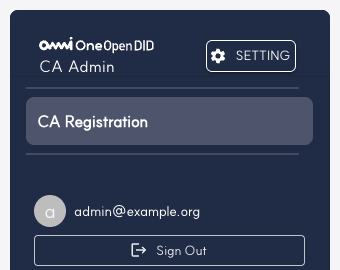

### 2.3.2. CA 등록 상태

CA 등록이 완료되면 전체 관리 기능이 활성화되며, 사이드바 메뉴는 다음과 같이 구성됩니다:

| 번호 | 기능 명칭 | 기능 설명 |
|------|-----------|-----------|
| 1 | **CA Management** | CA 서버의 기본 정보(DID, URL 등)를 확인하고 관리하는 메뉴입니다. |
| 2 | **User Management** | 시스템에 등록된 사용자 정보를 조회할 수 있는 메뉴입니다. 사용자의 개인 식별 정보(PII)를 확인할 수 있습니다. |
| 3 | **Log Management** | `API Log`에서 Agent API 호출을, `Audit API Log`에서 관리자 API 작업을 조회합니다. |
| 4 | **Server Configuration** | 외부 서버 연동 설정을 관리합니다. |
| 5 | **Admin Management** | 관리자 설정 상위 메뉴입니다. 하위에 `Admin Management`(관리자 계정)와 `Password Policy Settings`(비밀번호 정책)가 있습니다. |

각 메뉴에 대한 상세 기능은 [3. 기능별 상세 메뉴얼](#3-기능별-상세-메뉴얼) 섹션에서 자세히 설명합니다.

<br/>

## 2.4. 비밀번호 변경 관리

사용자 비밀번호 변경은 다음 단계를 통해 수행할 수 있습니다:

1. 헤더 영역의 'SETTING' 버튼을 클릭합니다.
2. 설정 메뉴에서 '비밀번호 변경'을 선택합니다.
3. 비밀번호 변경 화면에서:
   - 현재 비밀번호 입력
   - 새 비밀번호 입력
   - 새 비밀번호 확인 입력
4. '저장' 버튼을 클릭하여 변경 사항을 적용합니다.

> **참고**: 적용되는 최소 길이, 만료 기간, 문자 구성 규칙은 [비밀번호 정책 설정](#36-password-policy-settings)에서 확인합니다.

<br/>

# 3. 기능별 상세 메뉴얼

> 화면은 예시 데이터로 캡처했습니다. 실제 데이터는 환경에 따라 달라집니다.

이 장에서는 Open DID CA Admin Console의 주요 기능에 대한 상세 사용 방법을 안내합니다.

## 3.1. CA Management

CA Management는 CA 서버의 등록 및 상태 관리를 위한 기능입니다.

CA 서버는 Open DID 시스템에서 사용자의 Client Application을 보증하는 역할을 수행합니다. Client Application은 CA 서버를 통해 인증된 후 Wallet을 사용하여 DID 생성, VC 발급 등의 주요 기능을 사용할 수 있습니다.

CA 등록은 최초 1회만 수행되며, 이후에는 관리 화면에서 등록된 상태를 확인할 수 있습니다.

<br/>

### 3.1.1. CA 등록

CA 서버가 아직 등록되지 않은 초기 상태에서는 좌측 메뉴에 `CA Registration` 항목만 표시됩니다. CA 등록은 3단계로 진행합니다.

<br/>

**Step 1 – Enter CA Info**

CA의 이름과 서버 URL을 입력합니다.

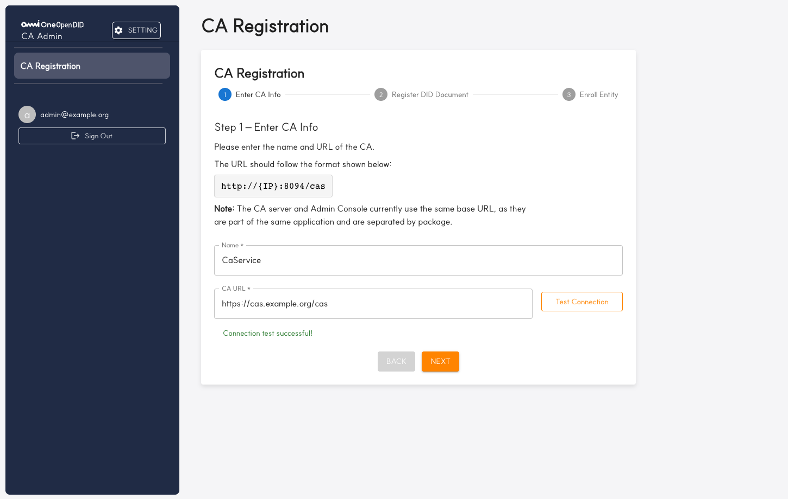

| 번호 | 항목 | 설명 |
| --- | --- | --- |
| 1 | **Name*** | CA 서버의 이름입니다. 영문 3~20자로 입력합니다. 예: `CaService` |
| 2 | **CA URL*** | CA 서버의 호출 URL입니다(200자 이내). 형식: `http://<IP>:8094/cas`, 화면 예시: `https://cas.example.org/cas` |
| 3 | **TEST CONNECTION 버튼** | 입력한 URL로 연결을 테스트합니다. |
| 4 | **NEXT 버튼** | 입력한 정보를 저장하고 다음 단계로 이동합니다. |

<br/>

**Step 2 – Register DID Document**

CA의 DID Document를 생성해 TA에 등록을 요청하고, TA 관리자의 승인을 확인합니다. 한 번 등록된 DID Document는 **변경하거나 재등록할 수 없습니다.**

▶ **Generate DID Document**

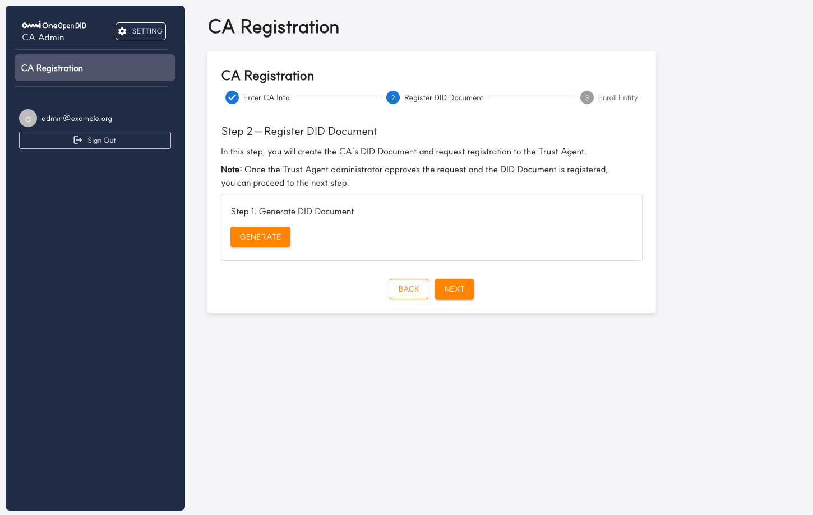

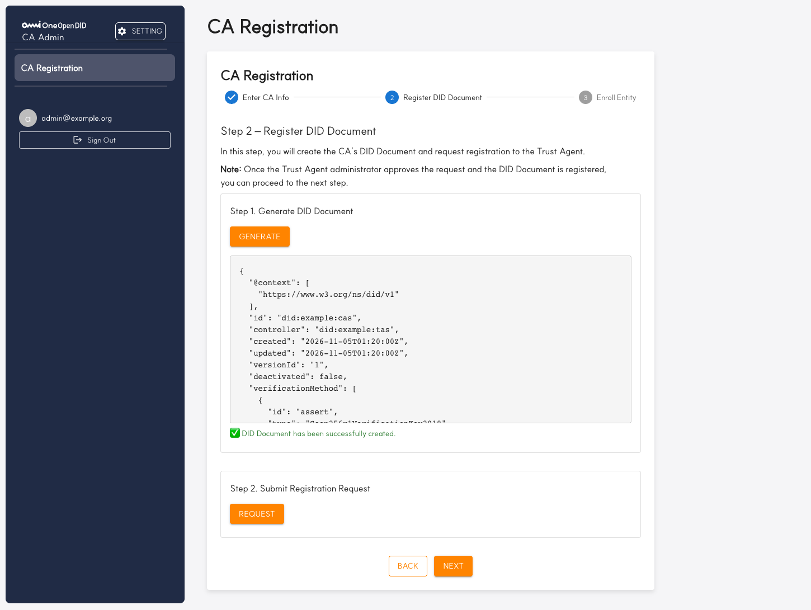

`GENERATE` 버튼을 누르면 DID Document가 생성되어 화면에 JSON으로 표시됩니다. 완료 메시지는 `DID Document has been successfully created.`입니다.

▶ **Submit Registration Request**

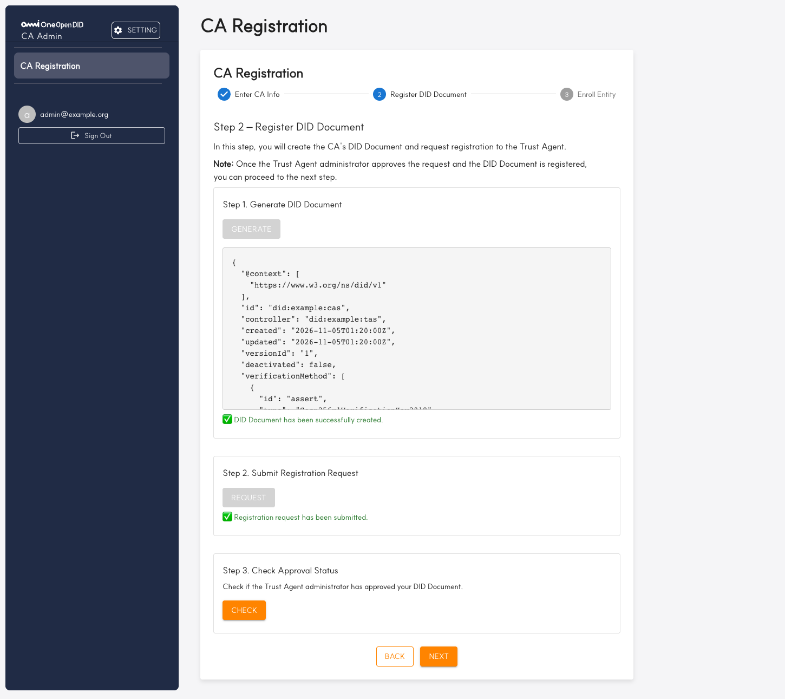

`REQUEST` 버튼을 누르면 TA에 DID Document 등록을 요청합니다. 완료 메시지는 `Registration request has been submitted.`입니다. TA 관리자는 TA Admin Console의 Entity 상세 화면에서 요청을 승인합니다.

▶ **Check Approval Status**

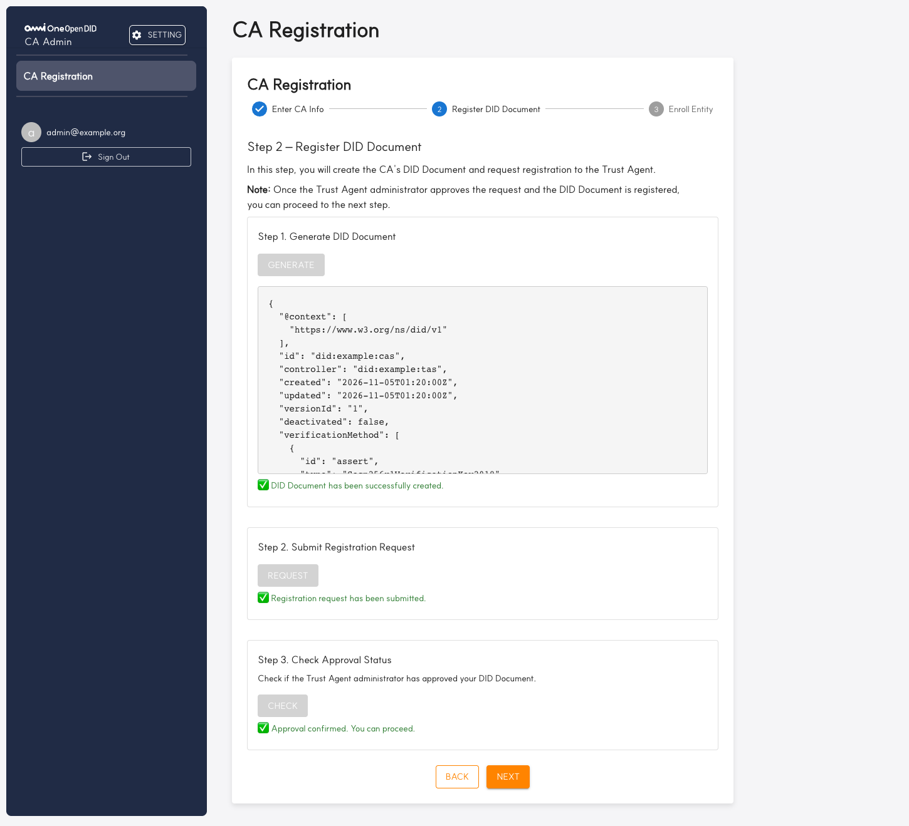

`CHECK` 버튼으로 승인 여부를 확인합니다.

| 상태 | 표시되는 메시지 | 동작 |
| --- | --- | --- |
| 승인 대기 | `The DID Document registration request is still pending approval.` | 승인 후 다시 확인합니다. |
| 승인됨 | `Approval confirmed. You can proceed.` | `NEXT` 버튼으로 다음 단계로 이동합니다. |
| 거절됨 | `The DID Document registration request has been rejected.` | 처음 화면으로 돌아갑니다. |

<br/>

**Step 3 – Register Entity and Issue Certificate VC**

TA에 CA를 Entity로 등록하고 가입증명서(Certificate VC)를 발급받습니다. CA Admin이 TA의 Entity 등록 프로토콜(P120)을 수행합니다.

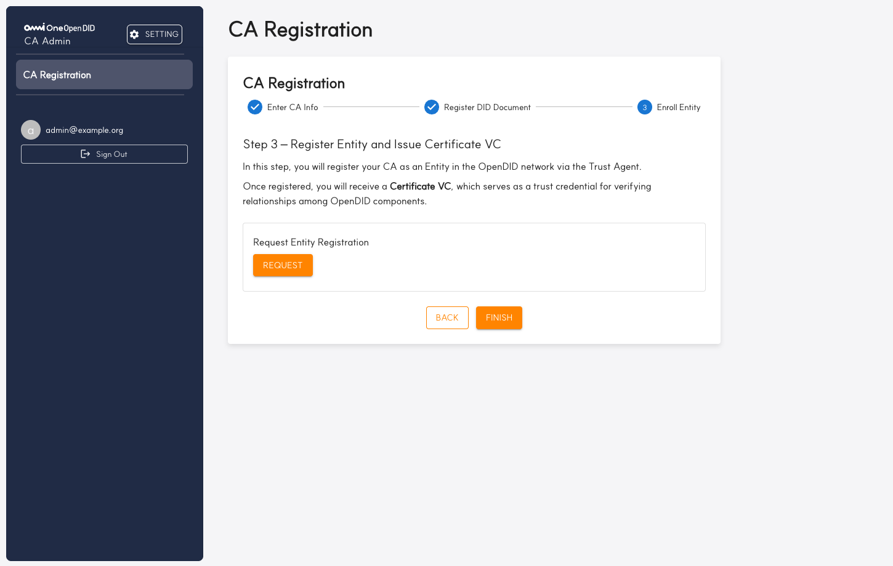

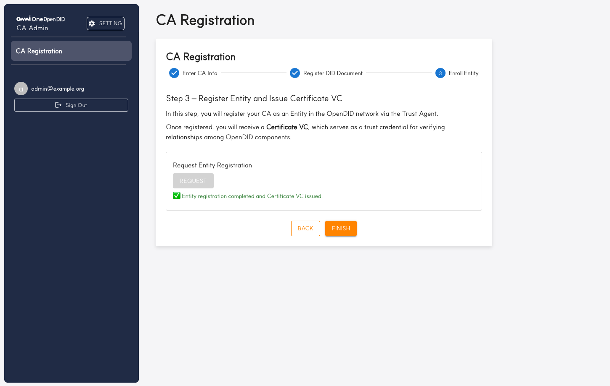

| 번호 | 항목 | 설명 |
| --- | --- | --- |
| 1 | **REQUEST 버튼** | TA에 Entity 등록을 요청합니다. 완료되면 `Entity registration completed and Certificate VC issued.`가 표시됩니다. |
| 2 | **BACK 버튼** | 이전 단계로 이동합니다. |
| 3 | **FINISH 버튼** | 등록을 마치고 완료 화면으로 이동합니다. |

<br/>

### 3.1.2. 등록된 CA 관리

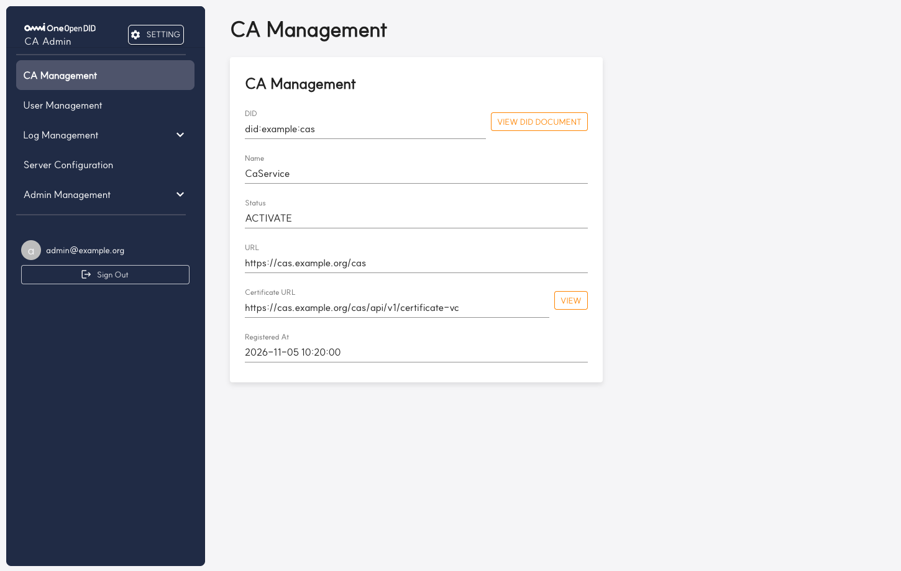

| 번호 | 항목 | 설명 |
| --- | --- | --- |
| 1 | **DID** | CA의 고유 식별자입니다. |
| 2 | **VIEW DID DOCUMENT 버튼** | DID Document를 팝업으로 표시합니다. |
| 3 | **Name** | CA의 이름입니다. |
| 4 | **Status** | 등록 상태입니다.<br/>- `DID_DOCUMENT_REQUIRED`: DID Document 등록 전<br/>- `DID_DOCUMENT_REQUESTED`: 등록 요청 후 승인 대기<br/>- `CERTIFICATE_VC_REQUIRED`: 승인 후 가입증명서 발급 전<br/>- `ACTIVATE`: 등록 완료<br/>- `DEACTIVATE`: 비활성 |
| 5 | **URL** | CA 서비스의 기본 URL입니다. |
| 6 | **Certificate URL** | 가입증명서를 확인할 수 있는 URL입니다. |
| 7 | **VIEW 버튼** | Certificate URL 옆의 버튼입니다. TA가 발급한 가입증명서 VC를 팝업으로 표시합니다. |
| 8 | **Registered At** | CA가 등록된 일시입니다. |

<br/>

## 3.2. User Management

시스템에 등록된 사용자 정보를 조회하는 메뉴입니다. 조회 전용이며 사용자 정보를 추가, 수정, 삭제하는 기능은 없습니다.

<br/>

### 3.2.1. 사용자 목록 조회

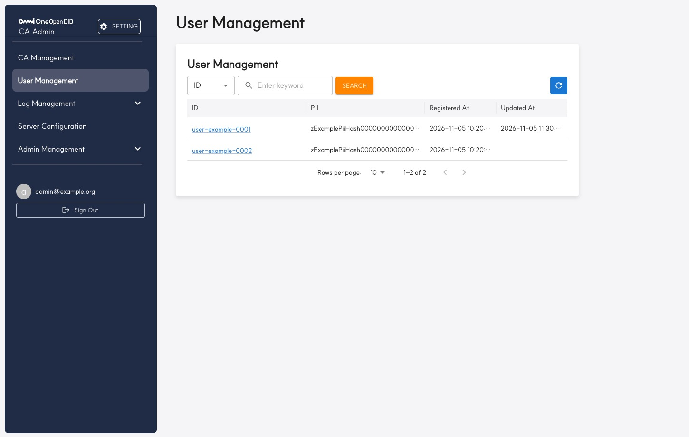

| 번호 | 항목 | 설명 |
| --- | --- | --- |
| 1 | **검색** | ID 또는 PII로 검색합니다. |
| 2 | **ID** | 사용자의 고유 식별자입니다. 클릭하면 상세 화면으로 이동합니다. |
| 3 | **PII** | 사용자의 개인 식별 정보입니다. |
| 4 | **Registered At** | 사용자가 등록된 일시입니다. |
| 5 | **Updated At** | 사용자 정보가 마지막으로 수정된 일시입니다. |

<br/>

### 3.2.2. 사용자 상세 정보 조회

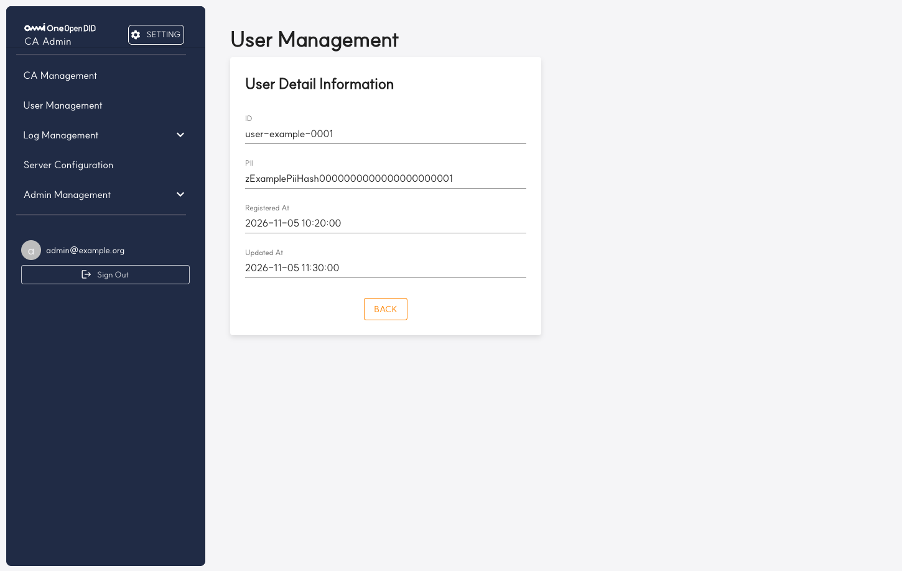

| 번호 | 항목 | 설명 |
| --- | --- | --- |
| 1 | **ID** | 사용자의 고유 식별자입니다. |
| 2 | **PII** | 사용자의 개인 식별 정보입니다. |
| 3 | **Registered At** | 사용자가 등록된 일시입니다. |
| 4 | **Updated At** | 사용자 정보가 마지막으로 수정된 일시입니다. |
| 5 | **BACK 버튼** | 목록 화면으로 돌아갑니다. |

> **중요**: 개인 식별 정보(PII)는 현재 시스템상 Demo Server를 통해 입력받은 임의의 값입니다. CA 서버는 사용자 정보를 갖고 있는 설정을 위해 해당 조회 기능을 제공합니다.

<br/>

## 3.3. Admin Management

`Admin Management` 메뉴는 CA Admin Console에 접근할 수 있는 관리자 계정을 관리하는 기능입니다.

CA 서버를 설치하면 기본적으로 `admin@opendid.omnione.net` 계정이 ROOT 권한으로 자동 생성됩니다. 이 계정은 시스템 내 유일한 ROOT 계정이며, 삭제할 수 없습니다.

관리자 계정은 **ROOT**와 **Normal Admin** 두 가지 권한 유형으로 구분됩니다.

> **참고**: 현재 ROOT와 Normal Admin의 차이는 `Admin Management` 메뉴에 표시되는 버튼뿐입니다(ROOT만 `REGISTER`, `DELETE`, `CHANGE PASSWORD` 가능). 다른 메뉴의 접근 권한이나 기능 제한은 아직 적용되어 있지 않습니다.

<br/>

### 3.3.1. Admin 목록 조회

`Admin Management` 메뉴에 진입하면 등록된 관리자 계정 목록이 표시됩니다.

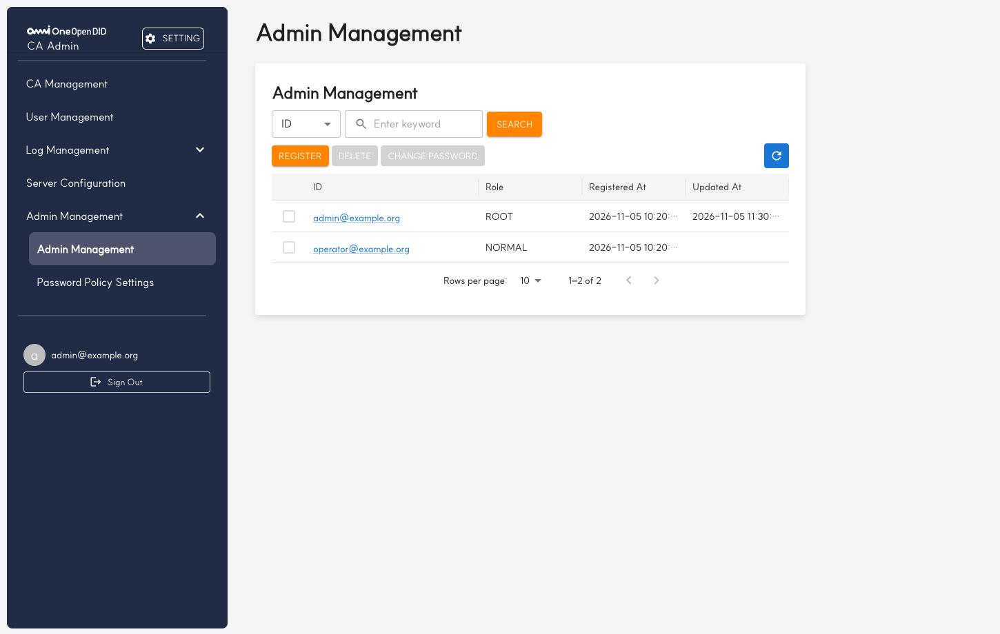

| 번호 | 항목 | 설명 |
| --- | --- | --- |
| 1 | **검색** | ID 또는 Role(Root, Normal)로 검색합니다. |
| 2 | **REGISTER 버튼** | 새 관리자 계정을 등록하는 화면으로 이동합니다. |
| 3 | **DELETE 버튼** | 선택한 관리자 계정을 삭제합니다. ROOT 관리자만 할 수 있습니다. |
| 4 | **CHANGE PASSWORD 버튼** | 선택한 관리자 계정의 비밀번호를 변경합니다. |
| 5 | **ID** | 관리자 계정의 이메일 ID입니다. |
| 6 | **Role** | 관리자 계정의 권한입니다. |
| 7 | **Registered At** | 계정이 등록된 일시입니다. |
| 8 | **Updated At** | 마지막으로 수정된 일시입니다. |

<br/>

### 3.3.2. Admin 등록

`REGISTER` 버튼을 클릭하면 등록 화면으로 이동합니다.

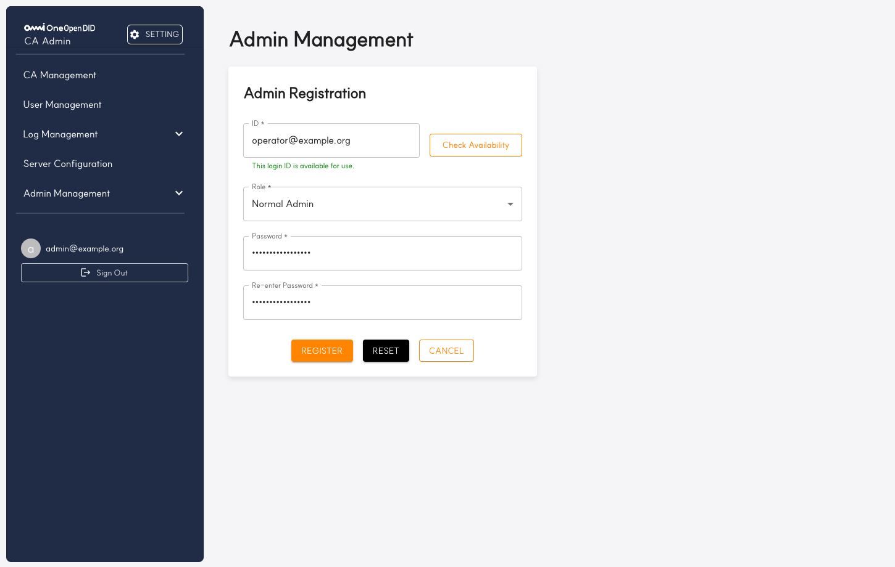

| 번호 | 항목 | 설명 |
| --- | --- | --- |
| 1 | **ID*** | 관리자 계정의 ID입니다. 이메일 형식 3~30자를 사용합니다. 예: `operator@example.org` |
| 2 | **Check Availability 버튼** | 입력한 ID가 중복되지 않는지 확인합니다. 등록하려면 확인을 통과해야 합니다. |
| 3 | **Role** | 관리자 계정의 권한을 선택합니다. 예: `Normal Admin` |
| 4 | **Password*** | 로그인에 사용할 비밀번호입니다(8~30자). 비밀번호 정책이 켜져 있으면 해당 규칙도 적용됩니다. |
| 5 | **Re-enter Password*** | 비밀번호를 한 번 더 입력합니다. |
| 6 | **REGISTER 버튼** | 입력한 정보로 관리자 계정을 등록합니다. |
| 7 | **RESET 버튼** | 입력값을 초기화합니다. |
| 8 | **CANCEL 버튼** | 등록을 취소하고 이전 화면으로 돌아갑니다. |

<br/>

## 3.4. Log Management

CA 등록이 완료되면 사이드바의 `Log Management`에서 API 호출 기록을 조회할 수 있습니다. 두 화면 모두 최신 기록부터 페이지별로 표시하고, 새로고침 버튼으로 목록을 다시 불러옵니다. `Called At`을 클릭하면 상세 창이 열립니다. 로그는 조회 전용입니다.

<br/>

### 3.4.1. API Log

`Log Management > API Log`(`/logs/api`)는 CA Agent API 호출 기록을 보여줍니다.


| 번호 | 항목 | 설명 |
| --- | --- | --- |
| 1 | **검색** | `URI` 또는 `Result`(`SUCCESS`, `FAIL`)로 검색합니다. |
| 2 | **Called At** | 호출 일시입니다. 클릭하면 상세 창이 열립니다. |
| 3 | **Method** | HTTP 메서드입니다. |
| 4 | **URI** | 호출한 URI입니다. |
| 5 | **Status** | HTTP 상태 코드입니다. |
| 6 | **Result** | `SUCCESS` 또는 `FAIL`입니다. |
| 7 | **Requester ID** | 요청자 ID입니다. |

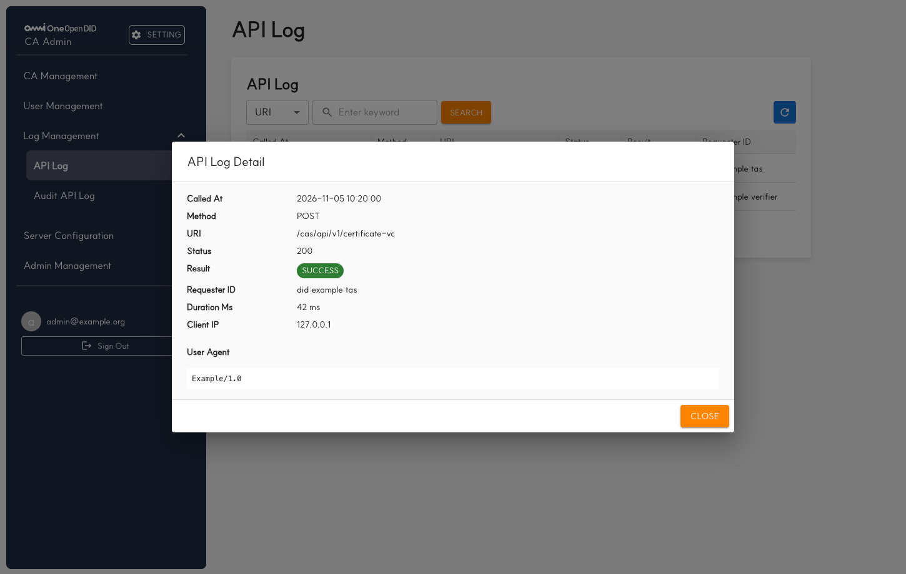

상세 창은 목록 항목에 더해 다음을 표시합니다.

| 항목 | 설명 |
| --- | --- |
| **Duration Ms** | 처리 시간(밀리초)입니다. |
| **Client IP** | 클라이언트 IP입니다. |
| **User Agent** | 요청의 User Agent입니다. |
| **Message** | 오류 메시지가 기록된 경우 표시합니다. |

<br/>

### 3.4.2. Audit API Log

`Log Management > Audit API Log`(`/logs/audit`)는 Admin API의 관리자 작업 기록을 보여줍니다.

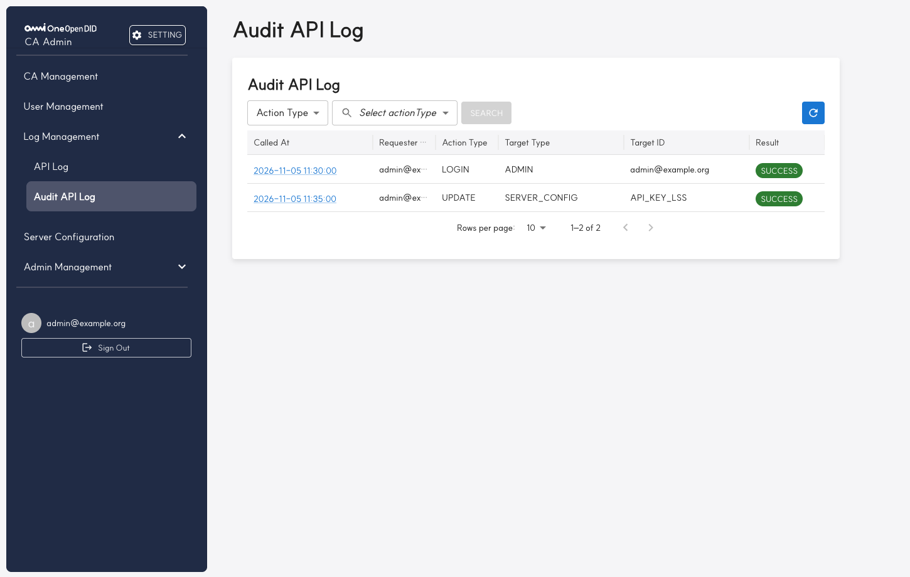

| 번호 | 항목 | 설명 |
| --- | --- | --- |
| 1 | **검색** | `Action Type`, `Target Type`, `Result`, `Requester ID`로 검색합니다. `Action Type`은 `NONE`, `CREATE`, `UPDATE`, `DELETE`, `LOGIN`, `LOGOUT` 중에서 선택합니다. |
| 2 | **Called At** | 호출 일시입니다. 클릭하면 상세 창이 열립니다. |
| 3 | **Requester ID** | 작업한 관리자 ID입니다. |
| 4 | **Action Type** | 작업 유형입니다. |
| 5 | **Target Type** | 작업 대상의 유형입니다. |
| 6 | **Target ID** | 작업 대상의 ID입니다. |
| 7 | **Result** | `SUCCESS` 또는 `FAIL`입니다. |

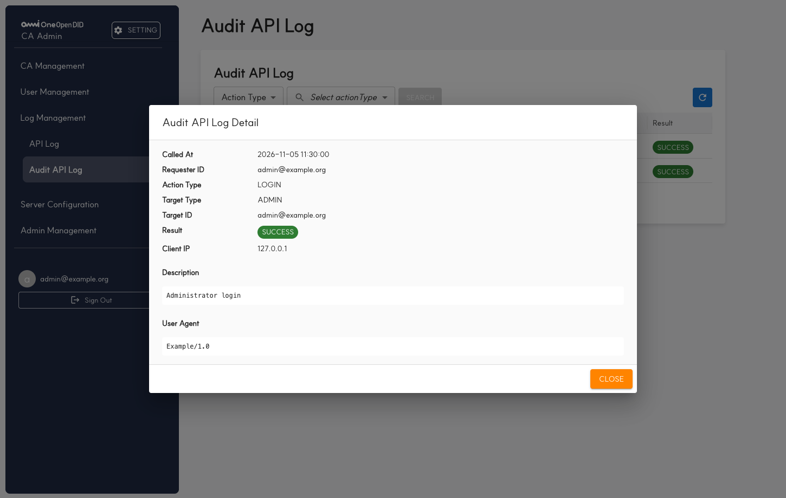

상세 창은 목록 항목에 더해 다음을 표시합니다.

| 항목 | 설명 |
| --- | --- |
| **Client IP** | 클라이언트 IP입니다. |
| **Description** | 작업 설명입니다. |
| **User Agent** | 요청의 User Agent입니다. |
| **Message** | 오류 메시지가 기록된 경우 표시합니다. |

> 로그는 서버의 `@ArticleLog`가 적용된 API 호출에서 생성됩니다. 결과가 `FAIL`이면 API Log의 상태 코드와 해당 로그의 상세 메시지를 확인하세요.

## 3.5. Server Configuration

`Server Configuration`에서 외부 서버 연동용 API 키를 설정합니다.

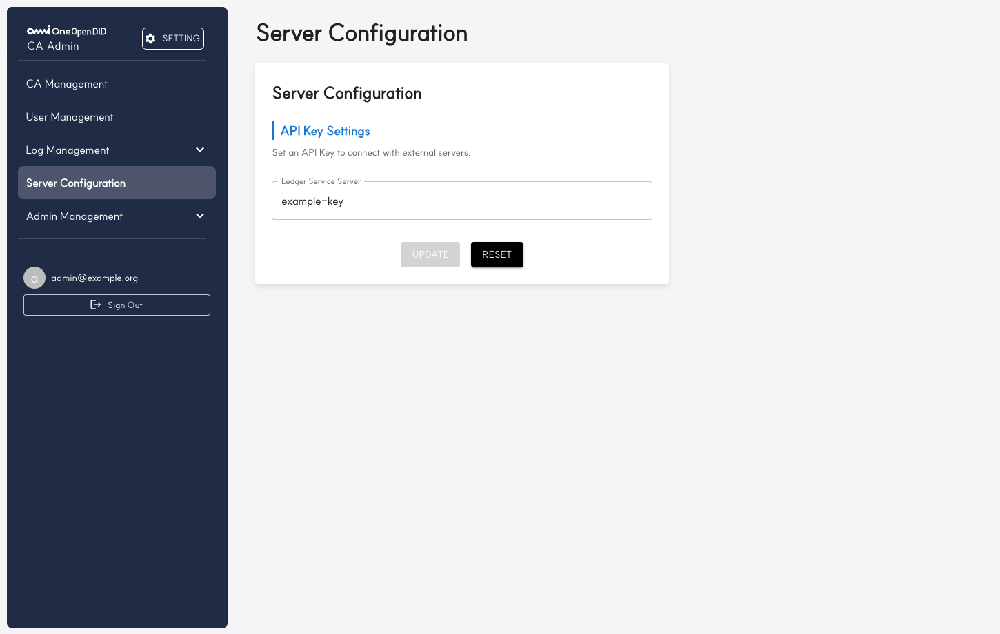

| 번호 | 항목 | 설명 |
| --- | --- | --- |
| 1 | **Ledger Service Server** | LSS에서 발급한 API Key를 입력합니다. `API_KEY_LSS`로 저장되며, CA 서버가 LSS를 호출할 때(`lss` 프로파일) `X-API-Key` 헤더로 보냅니다. |
| 2 | **UPDATE 버튼** | 입력한 값을 저장합니다. |
| 3 | **RESET 버튼** | 저장 전 입력값을 초기화합니다. |

키를 등록하지 않으면 LSS 호출이 `SCRVCFA01801`로 실패합니다.

> **주의**: API 키 값은 화면 캡처, 문서, 예시 설정에 포함하지 마세요.

## 3.6. Password Policy Settings

`Admin Management > Password Policy Settings`에서 관리자 비밀번호 규칙을 설정합니다. 규칙은 계정을 등록할 때와 비밀번호를 변경할 때 적용됩니다.

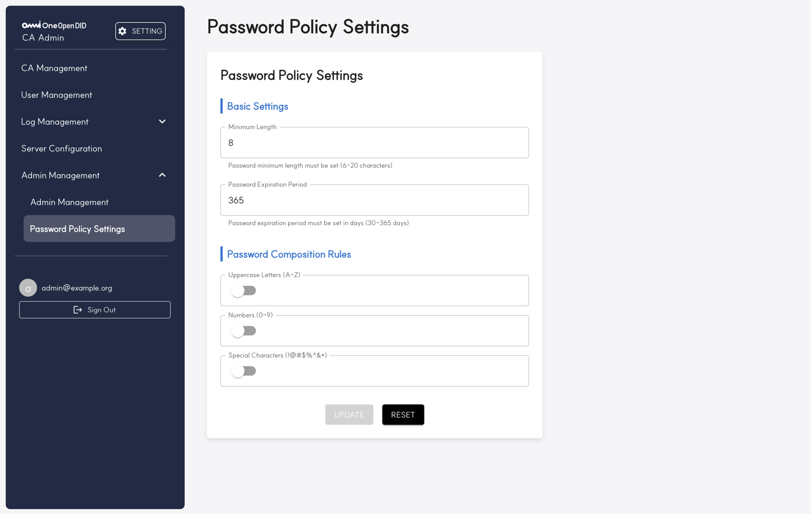

| 번호 | 항목 | 설명 |
| --- | --- | --- |
| 1 | **Minimum Length** | 비밀번호 최소 길이입니다. 6~20자로 설정합니다. 기본값은 8입니다. |
| 2 | **Password Expiration Period** | 비밀번호 만료 기간입니다. 30~365일로 설정합니다. 기본값은 365입니다. |
| 3 | **Uppercase Letters (A-Z)** | 대문자를 1자 이상 포함하게 합니다. 기본값은 꺼짐입니다. |
| 4 | **Numbers (0-9)** | 숫자를 1자 이상 포함하게 합니다. 기본값은 꺼짐입니다. |
| 5 | **Special Characters (!@#$%^&*)** | 특수문자를 1자 이상 포함하게 합니다. 기본값은 꺼짐입니다. |
| 6 | **UPDATE 버튼** | 정책을 저장합니다. 아직 등록하지 않았다면 버튼 이름은 `REGISTER`입니다. |
| 7 | **RESET 버튼** | 변경 전 입력 상태로 되돌립니다. |

[Open DID Installation Guide]: https://github.com/OmniOneID/did-release/blob/main/release-V2.0.0.0/OpenDID_Installation_Guide-V2.0.0.0_ko.md

